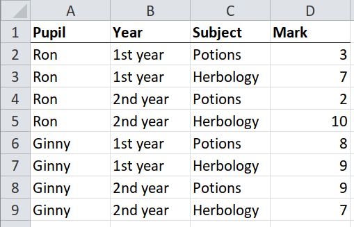
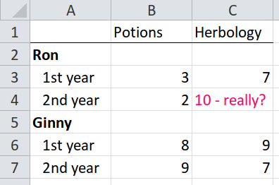
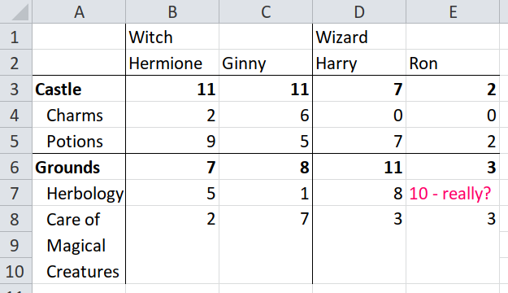
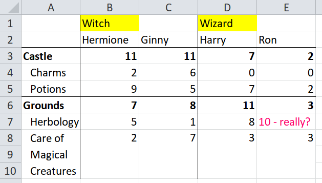
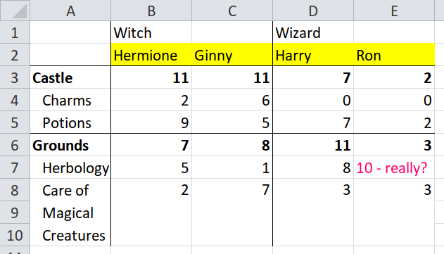
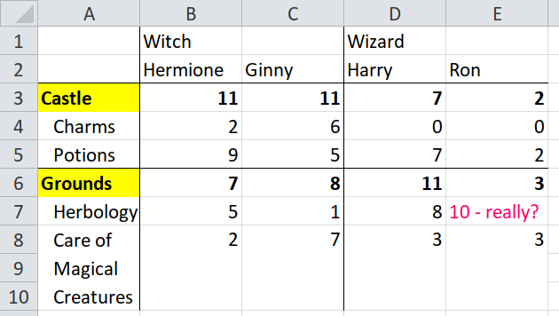
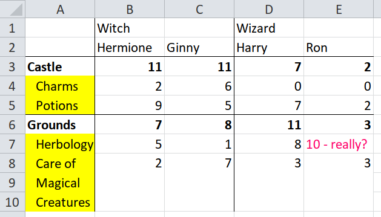

# Introduction to unpivotr

## Preface

This is based on a talk. You might want to watch the video or read the
[slides](https://docs.google.com/presentation/d/1tVwn_-QVGZTflnF9APiPACNvyAKqujdl6JmxmrdDjok)
(see speaker notes by clicking the cog):

<https://docs.google.com/presentation/d/1tVwn_-QVGZTflnF9APiPACNvyAKqujdl6JmxmrdDjok>

## 1. Reading easy spreadsheets with {readxl}

It is easy to read a spreadsheet into R when it has:

- A rectangular shape
- One row of column headers
- No meaningful colour or other formatting
- Consistent data types in each column, e.g. all numbers or all text

Here is an example, a dataset of student test marks in different
subjects.



To test whether a table will be easy to import, ask yourself “Is every
row self-sufficient? Could I read only one row and understand all the
data in it?” In this case, one row will tell you that Ron got two marks
in potions in his second year.

Because this table is simple – or ‘tidy’ – it is easily imported into a
data frame, using the {readxl} package.

``` r

library(readxl) # for read_excel()

hp_xlsx <- system.file("extdata/harry-potter.xlsx", package = "unpivotr")

tidy <- read_excel(hp_xlsx, sheet = "tidy")

tidy
#> # A tibble: 8 × 4
#>   Pupil Year     Subject    Mark
#>   <chr> <chr>    <chr>     <dbl>
#> 1 Ron   1st year Potions       3
#> 2 Ron   1st year Herbology     7
#> 3 Ron   2nd year Potions       2
#> 4 Ron   2nd year Herbology    10
#> 5 Ginny 1st year Potions       8
#> 6 Ginny 1st year Herbology     9
#> 7 Ginny 2nd year Potions       9
#> 8 Ginny 2nd year Herbology     7
```

Note that the row of column names in the spreadsheet has been used as
column names of the data frame. Also the data type of each column is
either `dbl` (double, which means a number), or `chr` (character) as
appropriate.

## 2. Trying to read a hard spreadsheet with {readxl}

Here’s is the same data but this time it is in a spreadsheet that the
{readxl} package can’t read so easily. Why not?



The `Pupil` and `Year` columns have been combined into one, so the names
of the pupils aren’t in the same rows as their marks, nor are they in
the same columns. There is also a text value `"10 - really?"` amongst a
column of numbers.

Is every row self-sufficient? Could you read only one row and understand
all the data in it? No, because one row will only tell you the mark,
subject and year, but not the name. Or else it will tell you the name,
but not the mark, subject or year.

Here is what happens when the table is read with the {readxl} package.

``` r

untidy <- read_excel(hp_xlsx, sheet = "untidy")
#> New names:
#> • `` -> `...1`

untidy
#> # A tibble: 6 × 3
#>   ...1     Potions Herbology   
#>   <chr>      <dbl> <chr>       
#> 1 Ron           NA NA          
#> 2 1st year       3 7           
#> 3 2nd year       2 10 - really?
#> 4 Ginny         NA NA          
#> 5 1st year       8 9           
#> 6 2nd year       9 7
```

What has gone wrong? The spreadsheet has broken the assumptions that the
{readxl} package makes about data.

- A rectangular shape. The spreadsheet is not rectangular because the
  top-left cell is deliberately blank (is not ‘missing’ data), and so
  are the cells to the right of `"Ron"` and `"Ginny"`.
- No meaningful colour or other formatting. The spreadsheet has
  meaningful formatting to distinguish between names in bold (`"Ron"`,
  `"Ginny"`) and years in plain type, (`"1st year"`, `"2nd year"`).
- Consistent data types in each column. The spreadsheet has mixed data
  types in the Herbology column, where some cells are numbers and one is
  text: `"10 - really?"`.

The `readxl` package has done its best with a difficult file.

- It has dealt with the non-rectangular shape by filling the gaps, using
  `...1` to fill the cell in the top-left corner with a column header,
  and `NA` to fill the cells to the right of `Ron` and `Ginny`.
- It has dealt with the mixed data types in the Herbology column by
  treating everything as text, even the numbers, so that it can
  accommodate the text value `"10 - really?"`.
- It hasn’t dealt with the meaningful formatting (bold names) because it
  is blind to formatting – {readxl} doesn’t know anything about
  formatting except for data types.

Unfortunately {readxl} hasn’t been able to make the data tidy. Each row
still isn’t self-sufficient. You couldn’t read only one row and
understand all the data in it.

Here is a final example of a spreadsheet that breaks the one remaining
assumption: that there is a single row of column headers. This file has
two rows of column headers.



The rest of this tutorial will demonstrate how to use the {tidyxl} and
{unpivotr} packages to import that spreadsheet.

## 3. Demonstration of {tidyxl} and {unpivotr}

Don’t expect to understand yet how the following code works. It is here
to show you what to expect later, and it is the entire code to import
the spreadsheet above.

``` r

library(dplyr)
#> 
#> Attaching package: 'dplyr'
#> The following objects are masked from 'package:stats':
#> 
#>     filter, lag
#> The following objects are masked from 'package:base':
#> 
#>     intersect, setdiff, setequal, union
library(tidyr)
library(tidyxl)
library(unpivotr)
#> 
#> Attaching package: 'unpivotr'
#> The following objects are masked from 'package:tidyr':
#> 
#>     pack, unpack

hp_xlsx <- system.file("extdata/harry-potter.xlsx", package = "unpivotr")

cells <- xlsx_cells(hp_xlsx, sheets = "pivoted")
formats <- xlsx_formats(hp_xlsx)

indent <- formats$local$alignment$indent

tidied <-
  cells %>%
  filter(!is_blank) %>%
  behead("up-left", "dormitory") %>%
  behead("up", "name") %>%
  behead_if(indent[local_format_id] == 0,
            direction = "left-up",
            name = "location") %>%
  behead("left", "subject") %>%
  select(address, dormitory, name, location, subject, mark = numeric) %>%
  arrange(dormitory, name, location, subject)

tidied
#> # A tibble: 24 × 6
#>    address dormitory name     location subject                    mark
#>    <chr>   <chr>     <chr>    <chr>    <chr>                     <dbl>
#>  1 C4      Witch     Ginny    Castle   Charms                        6
#>  2 C5      Witch     Ginny    Castle   Potions                       5
#>  3 C3      Witch     Ginny    Castle   NA                           11
#>  4 C8      Witch     Ginny    Grounds  Care of Magical Creatures     7
#>  5 C7      Witch     Ginny    Grounds  Herbology                     1
#>  6 C6      Witch     Ginny    Grounds  NA                            8
#>  7 B4      Witch     Hermione Castle   Charms                        2
#>  8 B5      Witch     Hermione Castle   Potions                       9
#>  9 B3      Witch     Hermione Castle   NA                           11
#> 10 B8      Witch     Hermione Grounds  Care of Magical Creatures     2
#> 11 B7      Witch     Hermione Grounds  Herbology                     5
#> 12 B6      Witch     Hermione Grounds  NA                            7
#> 13 D4      Wizard    Harry    Castle   Charms                        0
#> 14 D5      Wizard    Harry    Castle   Potions                       7
#> 15 D3      Wizard    Harry    Castle   NA                            7
#> 16 D8      Wizard    Harry    Grounds  Care of Magical Creatures     3
#> 17 D7      Wizard    Harry    Grounds  Herbology                     8
#> 18 D6      Wizard    Harry    Grounds  NA                           11
#> 19 E4      Wizard    Ron      Castle   Charms                        0
#> 20 E5      Wizard    Ron      Castle   Potions                       2
#> 21 E3      Wizard    Ron      Castle   NA                            2
#> 22 E8      Wizard    Ron      Grounds  Care of Magical Creatures     3
#> 23 E7      Wizard    Ron      Grounds  Herbology                    NA
#> 24 E6      Wizard    Ron      Grounds  NA                            3
```

## 4. Explanation of tidyxl::xlsx_cells()

The first step to import a difficult spreadsheet is to read it with
[`tidyxl::xlsx_cells()`](https://nacnudus.github.io/tidyxl/reference/xlsx_cells.html).

What does
[`tidyxl::xlsx_cells()`](https://nacnudus.github.io/tidyxl/reference/xlsx_cells.html)
do that is different from
[`readxl::read_excel()`](https://readxl.tidyverse.org/reference/read_excel.html)?
Instead of returning the *data* in a data frame, it returns *individual
cells* in a data frame. Try matching each row of the output of
[`xlsx_cells()`](https://nacnudus.github.io/tidyxl/reference/xlsx_cells.html)
to a cell in the spreadsheet.

``` r

cells <-
  xlsx_cells(hp_xlsx, sheets = "pivoted") %>%
  # Drop some columns to make it clearer what is going on
  select(row, col, is_blank, data_type, character, numeric, local_format_id)

cells
#> # A tibble: 47 × 7
#>      row   col is_blank data_type character              numeric local_format_id
#>    <int> <int> <lgl>    <chr>     <chr>                    <dbl>           <int>
#>  1     1     2 FALSE    character Witch                       NA               2
#>  2     1     4 FALSE    character Wizard                      NA               2
#>  3     2     1 TRUE     blank     NA                          NA               9
#>  4     2     2 FALSE    character Hermione                    NA               3
#>  5     2     3 FALSE    character Ginny                       NA               4
#>  6     2     4 FALSE    character Harry                       NA               3
#>  7     2     5 FALSE    character Ron                         NA               4
#>  8     3     1 FALSE    character Castle                      NA              12
#>  9     3     2 FALSE    numeric   NA                          11               5
#> 10     3     3 FALSE    numeric   NA                          11               6
#> 11     3     4 FALSE    numeric   NA                           7               5
#> 12     3     5 FALSE    numeric   NA                           2               6
#> 13     4     1 FALSE    character Charms                      NA              10
#> 14     4     2 FALSE    numeric   NA                           2               2
#> 15     4     3 FALSE    numeric   NA                           6               1
#> 16     4     4 FALSE    numeric   NA                           0               2
#> 17     4     5 FALSE    numeric   NA                           0               1
#> 18     5     1 FALSE    character Potions                     NA              11
#> 19     5     2 FALSE    numeric   NA                           9               3
#> 20     5     3 FALSE    numeric   NA                           5               4
#> 21     5     4 FALSE    numeric   NA                           7               3
#> 22     5     5 FALSE    numeric   NA                           2               4
#> 23     6     1 FALSE    character Grounds                     NA              12
#> 24     6     2 FALSE    numeric   NA                           7               5
#> 25     6     3 FALSE    numeric   NA                           8               6
#> 26     6     4 FALSE    numeric   NA                          11               5
#> 27     6     5 FALSE    numeric   NA                           3               6
#> 28     7     1 FALSE    character Herbology                   NA              10
#> 29     7     2 FALSE    numeric   NA                           5               2
#> 30     7     3 FALSE    numeric   NA                           1               1
#> 31     7     4 FALSE    numeric   NA                           8               2
#> 32     7     5 FALSE    character 10 - really?                NA              13
#> 33     8     1 FALSE    character Care of Magical Creat…      NA              14
#> 34     8     2 FALSE    numeric   NA                           2              15
#> 35     8     3 FALSE    numeric   NA                           7              17
#> 36     8     4 FALSE    numeric   NA                           3              15
#> 37     8     5 FALSE    numeric   NA                           3              16
#> 38     9     1 TRUE     blank     NA                          NA              14
#> 39     9     2 TRUE     blank     NA                          NA              15
#> 40     9     3 TRUE     blank     NA                          NA              17
#> 41     9     4 TRUE     blank     NA                          NA              15
#> 42     9     5 TRUE     blank     NA                          NA              16
#> 43    10     1 TRUE     blank     NA                          NA              14
#> 44    10     2 TRUE     blank     NA                          NA              15
#> 45    10     3 TRUE     blank     NA                          NA              17
#> 46    10     4 TRUE     blank     NA                          NA              15
#> 47    10     5 TRUE     blank     NA                          NA              16
```

The first row of the output describes the cell B2 (row 1, column 2) of
the spreadsheet, with the character value `"Witch"`.

    # A tibble: 47 x 7
         row   col is_blank data_type character numeric local_format_id
       <int> <int> <lgl>    <chr>     <chr>       <dbl>           <int>
     1     1     2 FALSE    character Witch          NA               2

Row 10 describes the cell C3 (row 3, column 3) of the spreadsheet, with
the numeric value `11`.

So what
[`xlsx_cells()`](https://nacnudus.github.io/tidyxl/reference/xlsx_cells.html)
has done is give you a data frame that isn’t data itself, but it
*describes* the data in the spreadsheet. Each row describes one cell.
This allows you to do some fancy tricks, like filter for all the numeric
cells.

``` r

cells %>%
  filter(data_type == "numeric")
#> # A tibble: 23 × 7
#>      row   col is_blank data_type character numeric local_format_id
#>    <int> <int> <lgl>    <chr>     <chr>       <dbl>           <int>
#>  1     3     2 FALSE    numeric   NA             11               5
#>  2     3     3 FALSE    numeric   NA             11               6
#>  3     3     4 FALSE    numeric   NA              7               5
#>  4     3     5 FALSE    numeric   NA              2               6
#>  5     4     2 FALSE    numeric   NA              2               2
#>  6     4     3 FALSE    numeric   NA              6               1
#>  7     4     4 FALSE    numeric   NA              0               2
#>  8     4     5 FALSE    numeric   NA              0               1
#>  9     5     2 FALSE    numeric   NA              9               3
#> 10     5     3 FALSE    numeric   NA              5               4
#> 11     5     4 FALSE    numeric   NA              7               3
#> 12     5     5 FALSE    numeric   NA              2               4
#> 13     6     2 FALSE    numeric   NA              7               5
#> 14     6     3 FALSE    numeric   NA              8               6
#> 15     6     4 FALSE    numeric   NA             11               5
#> 16     6     5 FALSE    numeric   NA              3               6
#> 17     7     2 FALSE    numeric   NA              5               2
#> 18     7     3 FALSE    numeric   NA              1               1
#> 19     7     4 FALSE    numeric   NA              8               2
#> 20     8     2 FALSE    numeric   NA              2              15
#> 21     8     3 FALSE    numeric   NA              7              17
#> 22     8     4 FALSE    numeric   NA              3              15
#> 23     8     5 FALSE    numeric   NA              3              16
```

Or you could filter for a particular cell by its row and column
position.

``` r

cells %>%
  filter(row == 2, col == 4)
#> # A tibble: 1 × 7
#>     row   col is_blank data_type character numeric local_format_id
#>   <int> <int> <lgl>    <chr>     <chr>       <dbl>           <int>
#> 1     2     4 FALSE    character Harry          NA               3
```

And you can filter out all ‘blank’ cells. A cell is ‘blank’ if it has
formatting but no value. Sometimes it’s useful to have these, but
usually you should discard them.

``` r

cells %>%
  filter(!is_blank)
#> # A tibble: 36 × 7
#>      row   col is_blank data_type character              numeric local_format_id
#>    <int> <int> <lgl>    <chr>     <chr>                    <dbl>           <int>
#>  1     1     2 FALSE    character Witch                       NA               2
#>  2     1     4 FALSE    character Wizard                      NA               2
#>  3     2     2 FALSE    character Hermione                    NA               3
#>  4     2     3 FALSE    character Ginny                       NA               4
#>  5     2     4 FALSE    character Harry                       NA               3
#>  6     2     5 FALSE    character Ron                         NA               4
#>  7     3     1 FALSE    character Castle                      NA              12
#>  8     3     2 FALSE    numeric   NA                          11               5
#>  9     3     3 FALSE    numeric   NA                          11               6
#> 10     3     4 FALSE    numeric   NA                           7               5
#> 11     3     5 FALSE    numeric   NA                           2               6
#> 12     4     1 FALSE    character Charms                      NA              10
#> 13     4     2 FALSE    numeric   NA                           2               2
#> 14     4     3 FALSE    numeric   NA                           6               1
#> 15     4     4 FALSE    numeric   NA                           0               2
#> 16     4     5 FALSE    numeric   NA                           0               1
#> 17     5     1 FALSE    character Potions                     NA              11
#> 18     5     2 FALSE    numeric   NA                           9               3
#> 19     5     3 FALSE    numeric   NA                           5               4
#> 20     5     4 FALSE    numeric   NA                           7               3
#> 21     5     5 FALSE    numeric   NA                           2               4
#> 22     6     1 FALSE    character Grounds                     NA              12
#> 23     6     2 FALSE    numeric   NA                           7               5
#> 24     6     3 FALSE    numeric   NA                           8               6
#> 25     6     4 FALSE    numeric   NA                          11               5
#> 26     6     5 FALSE    numeric   NA                           3               6
#> 27     7     1 FALSE    character Herbology                   NA              10
#> 28     7     2 FALSE    numeric   NA                           5               2
#> 29     7     3 FALSE    numeric   NA                           1               1
#> 30     7     4 FALSE    numeric   NA                           8               2
#> 31     7     5 FALSE    character 10 - really?                NA              13
#> 32     8     1 FALSE    character Care of Magical Creat…      NA              14
#> 33     8     2 FALSE    numeric   NA                           2              15
#> 34     8     3 FALSE    numeric   NA                           7              17
#> 35     8     4 FALSE    numeric   NA                           3              15
#> 36     8     5 FALSE    numeric   NA                           3              16
```

That is all you need to know about the tidyxl package for now. Later you
will be shown how to filter for cells by their formatting (e.g. bold
cells, indented cells, or cells with coloured text).

## 5. Explanation of unpivotr::behead()

You’ve seen that
[`tidyxl::xlsx_cells()`](https://nacnudus.github.io/tidyxl/reference/xlsx_cells.html)
reads a spreadsheet one cell at a time, so that you can filter for
particular cells by their position, their value, their data type, etc.
You could now write code to tidy up any spreadsheet.

The unpivotr package gives you some pre-packaged tools for tidying up a
spreadsheet. The most important tool is
[`behead()`](https://nacnudus.github.io/unpivotr/reference/behead.md),
which deals with one layer of header cells at a time.

Let’s look again at the original spreadsheet. I have highlighted the
first row of header cells.



Use
[`unpivotr::behead()`](https://nacnudus.github.io/unpivotr/reference/behead.md)
to tag data cells with `"Witch"` or `"Wizard"`, and then strip (or
behead!) those header cells from the rest – they are no longer required.

``` r

cells %>%
  filter(!is_blank) %>%
  behead("up-left", "dormitory")
#> # A tibble: 34 × 8
#>      row   col is_blank data_type character    numeric local_format_id dormitory
#>    <int> <int> <lgl>    <chr>     <chr>          <dbl>           <int> <chr>    
#>  1     2     2 FALSE    character Hermione          NA               3 Witch    
#>  2     2     3 FALSE    character Ginny             NA               4 Witch    
#>  3     3     2 FALSE    numeric   NA                11               5 Witch    
#>  4     3     3 FALSE    numeric   NA                11               6 Witch    
#>  5     4     2 FALSE    numeric   NA                 2               2 Witch    
#>  6     4     3 FALSE    numeric   NA                 6               1 Witch    
#>  7     5     2 FALSE    numeric   NA                 9               3 Witch    
#>  8     5     3 FALSE    numeric   NA                 5               4 Witch    
#>  9     6     2 FALSE    numeric   NA                 7               5 Witch    
#> 10     6     3 FALSE    numeric   NA                 8               6 Witch    
#> 11     7     2 FALSE    numeric   NA                 5               2 Witch    
#> 12     7     3 FALSE    numeric   NA                 1               1 Witch    
#> 13     8     2 FALSE    numeric   NA                 2              15 Witch    
#> 14     8     3 FALSE    numeric   NA                 7              17 Witch    
#> 15     2     4 FALSE    character Harry             NA               3 Wizard   
#> 16     2     5 FALSE    character Ron               NA               4 Wizard   
#> 17     3     4 FALSE    numeric   NA                 7               5 Wizard   
#> 18     3     5 FALSE    numeric   NA                 2               6 Wizard   
#> 19     4     4 FALSE    numeric   NA                 0               2 Wizard   
#> 20     4     5 FALSE    numeric   NA                 0               1 Wizard   
#> 21     5     4 FALSE    numeric   NA                 7               3 Wizard   
#> 22     5     5 FALSE    numeric   NA                 2               4 Wizard   
#> 23     6     4 FALSE    numeric   NA                11               5 Wizard   
#> 24     6     5 FALSE    numeric   NA                 3               6 Wizard   
#> 25     7     4 FALSE    numeric   NA                 8               2 Wizard   
#> 26     7     5 FALSE    character 10 - really?      NA              13 Wizard   
#> 27     8     4 FALSE    numeric   NA                 3              15 Wizard   
#> 28     8     5 FALSE    numeric   NA                 3              16 Wizard   
#> 29     3     1 FALSE    character Castle            NA              12 NA       
#> 30     4     1 FALSE    character Charms            NA              10 NA       
#> 31     5     1 FALSE    character Potions           NA              11 NA       
#> 32     6     1 FALSE    character Grounds           NA              12 NA       
#> 33     7     1 FALSE    character Herbology         NA              10 NA       
#> 34     8     1 FALSE    character Care of Mag…      NA              14 NA
```

Click through table to check that every cell belonging to the Witch
header has been taggged `"Witch"` in the column `dormitory`, and the
same for wizards Notice that the locations `Castle` and `Grounds` have
also been tagged witch or wizard. Also, all the cells in row 1 have
disappeared – they have become values in the `dormitory` column.

What do the arguments to `behead("up-left", "dormitory")` mean? The
second one, `"dormitory"` becomes the column name of the male/female
tags. But the direction `"up-left"` is the most important one. It tells
[`behead()`](https://nacnudus.github.io/unpivotr/reference/behead.md)
which way to look for a header cell.

For example, starting from the cell C3 (row 3 column 3),
[`behead()`](https://nacnudus.github.io/unpivotr/reference/behead.md)
looks up and to the left to find the header `"Witch"`. Starting from the
cell D4 (row 4, column 4) it finds the header `"Wizard"`. Starting from
cells in the first column, there is no header cell in the `"up-left"`
direction, so they are tagged with missing values. Don’t worry about
them – they will come right later.

What if we try a different direction instead, `"up-right"` (up and to
the right)? Again, compare the table with the spreadsheet


``` r

cells %>%
  filter(!is_blank) %>%
  behead("up-right", "dormitory")
#> # A tibble: 34 × 8
#>      row   col is_blank data_type character    numeric local_format_id dormitory
#>    <int> <int> <lgl>    <chr>     <chr>          <dbl>           <int> <chr>    
#>  1     2     2 FALSE    character Hermione          NA               3 Witch    
#>  2     3     1 FALSE    character Castle            NA              12 Witch    
#>  3     3     2 FALSE    numeric   NA                11               5 Witch    
#>  4     4     1 FALSE    character Charms            NA              10 Witch    
#>  5     4     2 FALSE    numeric   NA                 2               2 Witch    
#>  6     5     1 FALSE    character Potions           NA              11 Witch    
#>  7     5     2 FALSE    numeric   NA                 9               3 Witch    
#>  8     6     1 FALSE    character Grounds           NA              12 Witch    
#>  9     6     2 FALSE    numeric   NA                 7               5 Witch    
#> 10     7     1 FALSE    character Herbology         NA              10 Witch    
#> 11     7     2 FALSE    numeric   NA                 5               2 Witch    
#> 12     8     1 FALSE    character Care of Mag…      NA              14 Witch    
#> 13     8     2 FALSE    numeric   NA                 2              15 Witch    
#> 14     2     3 FALSE    character Ginny             NA               4 Wizard   
#> 15     2     4 FALSE    character Harry             NA               3 Wizard   
#> 16     3     3 FALSE    numeric   NA                11               6 Wizard   
#> 17     3     4 FALSE    numeric   NA                 7               5 Wizard   
#> 18     4     3 FALSE    numeric   NA                 6               1 Wizard   
#> 19     4     4 FALSE    numeric   NA                 0               2 Wizard   
#> 20     5     3 FALSE    numeric   NA                 5               4 Wizard   
#> 21     5     4 FALSE    numeric   NA                 7               3 Wizard   
#> 22     6     3 FALSE    numeric   NA                 8               6 Wizard   
#> 23     6     4 FALSE    numeric   NA                11               5 Wizard   
#> 24     7     3 FALSE    numeric   NA                 1               1 Wizard   
#> 25     7     4 FALSE    numeric   NA                 8               2 Wizard   
#> 26     8     3 FALSE    numeric   NA                 7              17 Wizard   
#> 27     8     4 FALSE    numeric   NA                 3              15 Wizard   
#> 28     2     5 FALSE    character Ron               NA               4 NA       
#> 29     3     5 FALSE    numeric   NA                 2               6 NA       
#> 30     4     5 FALSE    numeric   NA                 0               1 NA       
#> 31     5     5 FALSE    numeric   NA                 2               4 NA       
#> 32     6     5 FALSE    numeric   NA                 3               6 NA       
#> 33     7     5 FALSE    character 10 - really?      NA              13 NA       
#> 34     8     5 FALSE    numeric   NA                 3              16 NA
```

Check that Ginny has been tagged `"Wizard"`, and so have her marks in
cells below. Unpivotr doesn’t know that this is wrong, it has just done
what it was told. The
[`behead()`](https://nacnudus.github.io/unpivotr/reference/behead.md)
function isn’t magic, it just enables you to tell unpivotr which data
cells relate to which header cells.

## 6. Continuing `unpivotr::behead()`

Let’s carry on with the second row of header cells (highlighted). This
time the direction is simply `"up"` for directly up because there is a
header in every column. Notice that we’re building up a pipeline of
transformations, one set of headers at a time.



``` r

cells %>%
  filter(!is_blank) %>%
  behead("up-left", "dormitory") %>%
  behead("up", "name")
#> # A tibble: 30 × 9
#>      row   col is_blank data_type character    numeric local_format_id dormitory
#>    <int> <int> <lgl>    <chr>     <chr>          <dbl>           <int> <chr>    
#>  1     3     2 FALSE    numeric   NA                11               5 Witch    
#>  2     3     3 FALSE    numeric   NA                11               6 Witch    
#>  3     4     2 FALSE    numeric   NA                 2               2 Witch    
#>  4     4     3 FALSE    numeric   NA                 6               1 Witch    
#>  5     5     2 FALSE    numeric   NA                 9               3 Witch    
#>  6     5     3 FALSE    numeric   NA                 5               4 Witch    
#>  7     6     2 FALSE    numeric   NA                 7               5 Witch    
#>  8     6     3 FALSE    numeric   NA                 8               6 Witch    
#>  9     7     2 FALSE    numeric   NA                 5               2 Witch    
#> 10     7     3 FALSE    numeric   NA                 1               1 Witch    
#> 11     8     2 FALSE    numeric   NA                 2              15 Witch    
#> 12     8     3 FALSE    numeric   NA                 7              17 Witch    
#> 13     3     4 FALSE    numeric   NA                 7               5 Wizard   
#> 14     3     5 FALSE    numeric   NA                 2               6 Wizard   
#> 15     4     4 FALSE    numeric   NA                 0               2 Wizard   
#> 16     4     5 FALSE    numeric   NA                 0               1 Wizard   
#> 17     5     4 FALSE    numeric   NA                 7               3 Wizard   
#> 18     5     5 FALSE    numeric   NA                 2               4 Wizard   
#> 19     6     4 FALSE    numeric   NA                11               5 Wizard   
#> 20     6     5 FALSE    numeric   NA                 3               6 Wizard   
#> 21     7     4 FALSE    numeric   NA                 8               2 Wizard   
#> 22     7     5 FALSE    character 10 - really?      NA              13 Wizard   
#> 23     8     4 FALSE    numeric   NA                 3              15 Wizard   
#> 24     8     5 FALSE    numeric   NA                 3              16 Wizard   
#> 25     3     1 FALSE    character Castle            NA              12 NA       
#> 26     4     1 FALSE    character Charms            NA              10 NA       
#> 27     5     1 FALSE    character Potions           NA              11 NA       
#> 28     6     1 FALSE    character Grounds           NA              12 NA       
#> 29     7     1 FALSE    character Herbology         NA              10 NA       
#> 30     8     1 FALSE    character Care of Mag…      NA              14 NA       
#> # ℹ 1 more variable: name <chr>
```

Click through the table to match it to the spreadsheet. The header cells
in rows 1 and 2 have all disappeared to become values in the `dormitory`
and `name` columns. The cell C3 (row 3, column 3) has been tagged
`"Witch"` and `"Ginny"`

## 7. Handling meaningful formatting with `unpivotr::behead_if()`

Applying the same procedure to the headers in column A, which describe
the location and subject, what are the directions?

Starting from a data cell, say, B7 (row 7, column 2), the location
is`"Grounds"`, which is to the left and then up, `"left-up"`.



But there is a complication. When
[`unpivotr::behead()`](https://nacnudus.github.io/unpivotr/reference/behead.md)
is travelling up the cells in column 1, how does it know to stop at
`"Grounds"` and not overshoot to `"Potions"` or any of the cells further
up? You must tell
[`behead()`](https://nacnudus.github.io/unpivotr/reference/behead.md) to
stop at the first cell that isn’t indented. Alternatively, you could
tell it to stop at the first cell that is bold.

Use
[`unpivotr::behead_if()`](https://nacnudus.github.io/unpivotr/reference/behead.md)
when there is a rule to identify a header cell. In this case the rule
will be “when the cell has bold formatting”.

A spreadsheet cell can have so many different formats that it would be
unweildy for {tidyxl} to import them all at once. Instead, {tidyxl}
imports a kind of lookup table of formatting, and each cell has a key
into the lookup table, called `local_format_id`.

Here’s how to look up the `indented` property of a cell.

``` r

formats <- xlsx_formats(hp_xlsx) # load the format lookup table from the file

indent <- formats$local$alignment$indent # find the 'indent' property

indent[cells$local_format_id] # look up the indent property of each cell
#>  [1] 0 0 0 0 0 0 0 0 0 0 0 0 1 0 0 0 0 1 0 0 0 0 0 0 0 0 0 1 0 0 0 0 1 0 0 0 0 1
#> [39] 0 0 0 0 1 0 0 0 0
```

When you look up a format from inside
[`behead_if()`](https://nacnudus.github.io/unpivotr/reference/behead.md),
you don’t need to mention `cell$`, but you do have to name the other
arguments to
[`behead()`](https://nacnudus.github.io/unpivotr/reference/behead.md).

``` r

formats <- xlsx_formats(hp_xlsx) # load the format lookup table from the file
indent <- formats$local$alignment$indent # find the 'indent' property

cells %>%
  filter(!is_blank) %>%
  behead("up-left", "dormitory") %>%
  behead("up", "name") %>%
  behead_if(indent[local_format_id] == 0,
            direction = "left-up", # This argument has to be named now.
            name = "location")     # So does this one.
#> # A tibble: 28 × 10
#>      row   col is_blank data_type character    numeric local_format_id dormitory
#>    <int> <int> <lgl>    <chr>     <chr>          <dbl>           <int> <chr>    
#>  1     3     2 FALSE    numeric   NA                11               5 Witch    
#>  2     3     3 FALSE    numeric   NA                11               6 Witch    
#>  3     4     2 FALSE    numeric   NA                 2               2 Witch    
#>  4     4     3 FALSE    numeric   NA                 6               1 Witch    
#>  5     5     2 FALSE    numeric   NA                 9               3 Witch    
#>  6     5     3 FALSE    numeric   NA                 5               4 Witch    
#>  7     3     4 FALSE    numeric   NA                 7               5 Wizard   
#>  8     3     5 FALSE    numeric   NA                 2               6 Wizard   
#>  9     4     4 FALSE    numeric   NA                 0               2 Wizard   
#> 10     4     5 FALSE    numeric   NA                 0               1 Wizard   
#> 11     5     4 FALSE    numeric   NA                 7               3 Wizard   
#> 12     5     5 FALSE    numeric   NA                 2               4 Wizard   
#> 13     4     1 FALSE    character Charms            NA              10 NA       
#> 14     5     1 FALSE    character Potions           NA              11 NA       
#> 15     6     2 FALSE    numeric   NA                 7               5 Witch    
#> 16     6     3 FALSE    numeric   NA                 8               6 Witch    
#> 17     7     2 FALSE    numeric   NA                 5               2 Witch    
#> 18     7     3 FALSE    numeric   NA                 1               1 Witch    
#> 19     8     2 FALSE    numeric   NA                 2              15 Witch    
#> 20     8     3 FALSE    numeric   NA                 7              17 Witch    
#> 21     6     4 FALSE    numeric   NA                11               5 Wizard   
#> 22     6     5 FALSE    numeric   NA                 3               6 Wizard   
#> 23     7     4 FALSE    numeric   NA                 8               2 Wizard   
#> 24     7     5 FALSE    character 10 - really?      NA              13 Wizard   
#> 25     8     4 FALSE    numeric   NA                 3              15 Wizard   
#> 26     8     5 FALSE    numeric   NA                 3              16 Wizard   
#> 27     7     1 FALSE    character Herbology         NA              10 NA       
#> 28     8     1 FALSE    character Care of Mag…      NA              14 NA       
#> # ℹ 2 more variables: name <chr>, location <chr>
```

You can give more than one rule to
[`behead_if()`](https://nacnudus.github.io/unpivotr/reference/behead.md)
at once. They are applied together, so all the rules must evaluate to
`TRUE` for a cell to be treated as a header cell. Here’s an example
applying the additional rule that a cell must be bold. The result in
this case is the same.

``` r

formats <- xlsx_formats(hp_xlsx)
indent <- formats$local$alignment$indent
bold <- formats$local$font$bold # find the 'bold' property

cells %>%
  filter(!is_blank) %>%
  behead("up-left", "dormitory") %>%
  behead("up", "name") %>%
  behead_if(indent[local_format_id] == 0, # First rule
            bold[local_format_id],        # Second rule. Both must be TRUE
            direction = "left-up",
            name = "location")
#> # A tibble: 28 × 10
#>      row   col is_blank data_type character    numeric local_format_id dormitory
#>    <int> <int> <lgl>    <chr>     <chr>          <dbl>           <int> <chr>    
#>  1     3     2 FALSE    numeric   NA                11               5 Witch    
#>  2     3     3 FALSE    numeric   NA                11               6 Witch    
#>  3     4     2 FALSE    numeric   NA                 2               2 Witch    
#>  4     4     3 FALSE    numeric   NA                 6               1 Witch    
#>  5     5     2 FALSE    numeric   NA                 9               3 Witch    
#>  6     5     3 FALSE    numeric   NA                 5               4 Witch    
#>  7     3     4 FALSE    numeric   NA                 7               5 Wizard   
#>  8     3     5 FALSE    numeric   NA                 2               6 Wizard   
#>  9     4     4 FALSE    numeric   NA                 0               2 Wizard   
#> 10     4     5 FALSE    numeric   NA                 0               1 Wizard   
#> 11     5     4 FALSE    numeric   NA                 7               3 Wizard   
#> 12     5     5 FALSE    numeric   NA                 2               4 Wizard   
#> 13     4     1 FALSE    character Charms            NA              10 NA       
#> 14     5     1 FALSE    character Potions           NA              11 NA       
#> 15     6     2 FALSE    numeric   NA                 7               5 Witch    
#> 16     6     3 FALSE    numeric   NA                 8               6 Witch    
#> 17     7     2 FALSE    numeric   NA                 5               2 Witch    
#> 18     7     3 FALSE    numeric   NA                 1               1 Witch    
#> 19     8     2 FALSE    numeric   NA                 2              15 Witch    
#> 20     8     3 FALSE    numeric   NA                 7              17 Witch    
#> 21     6     4 FALSE    numeric   NA                11               5 Wizard   
#> 22     6     5 FALSE    numeric   NA                 3               6 Wizard   
#> 23     7     4 FALSE    numeric   NA                 8               2 Wizard   
#> 24     7     5 FALSE    character 10 - really?      NA              13 Wizard   
#> 25     8     4 FALSE    numeric   NA                 3              15 Wizard   
#> 26     8     5 FALSE    numeric   NA                 3              16 Wizard   
#> 27     7     1 FALSE    character Herbology         NA              10 NA       
#> 28     8     1 FALSE    character Care of Mag…      NA              14 NA       
#> # ℹ 2 more variables: name <chr>, location <chr>
```

Check that Hermione got 5 marks in a subject taken in Hogwarts grounds,
by looking at cell B7 (row 7, column 2).

## 8. Finishing and cleaning up

Only one layer of headers remains: the subjects in column 1. The
direction is directly `"left"`.



``` r

cells %>%
  filter(!is_blank) %>%
  behead("up-left", "dormitory") %>%
  behead("up", "name") %>%
  behead_if(indent[local_format_id] == 0,
            direction = "left-up",
            name = "location") %>%
  behead("left", "subject")
#> # A tibble: 24 × 11
#>      row   col is_blank data_type character    numeric local_format_id dormitory
#>    <int> <int> <lgl>    <chr>     <chr>          <dbl>           <int> <chr>    
#>  1     3     2 FALSE    numeric   NA                11               5 Witch    
#>  2     3     3 FALSE    numeric   NA                11               6 Witch    
#>  3     4     2 FALSE    numeric   NA                 2               2 Witch    
#>  4     4     3 FALSE    numeric   NA                 6               1 Witch    
#>  5     5     2 FALSE    numeric   NA                 9               3 Witch    
#>  6     5     3 FALSE    numeric   NA                 5               4 Witch    
#>  7     3     4 FALSE    numeric   NA                 7               5 Wizard   
#>  8     3     5 FALSE    numeric   NA                 2               6 Wizard   
#>  9     4     4 FALSE    numeric   NA                 0               2 Wizard   
#> 10     4     5 FALSE    numeric   NA                 0               1 Wizard   
#> 11     5     4 FALSE    numeric   NA                 7               3 Wizard   
#> 12     5     5 FALSE    numeric   NA                 2               4 Wizard   
#> 13     6     2 FALSE    numeric   NA                 7               5 Witch    
#> 14     6     3 FALSE    numeric   NA                 8               6 Witch    
#> 15     7     2 FALSE    numeric   NA                 5               2 Witch    
#> 16     7     3 FALSE    numeric   NA                 1               1 Witch    
#> 17     8     2 FALSE    numeric   NA                 2              15 Witch    
#> 18     8     3 FALSE    numeric   NA                 7              17 Witch    
#> 19     6     4 FALSE    numeric   NA                11               5 Wizard   
#> 20     6     5 FALSE    numeric   NA                 3               6 Wizard   
#> 21     7     4 FALSE    numeric   NA                 8               2 Wizard   
#> 22     7     5 FALSE    character 10 - really?      NA              13 Wizard   
#> 23     8     4 FALSE    numeric   NA                 3              15 Wizard   
#> 24     8     5 FALSE    numeric   NA                 3              16 Wizard   
#> # ℹ 3 more variables: name <chr>, location <chr>, subject <chr>
```

Check that Hermione got 5 marks in Herbology in particular, taken in
Hogwarts grounds, by looking at cell B7 (row 7, column 2).

The final cleanup is straightforward; choose the columns to keep, using
the standard tidyverse function
[`dplyr::select()`](https://dplyr.tidyverse.org/reference/select.html).
At the same time you can rename the column `numeric` to `mark`, and the
column `character` to `other`. What is the column `other` for? For the
value `"10 - really?"`.

``` r

cells %>%
  filter(!is_blank) %>%
  behead("up-left", "dormitory") %>%
  behead("up", "name") %>%
  behead_if(indent[local_format_id] == 0,
            direction = "left-up",
            name = "location") %>%
  behead("left", "subject") %>%
  select(dormitory, name, location, subject, mark = numeric, other = character)
#> # A tibble: 24 × 6
#>    dormitory name     location subject                    mark other       
#>    <chr>     <chr>    <chr>    <chr>                     <dbl> <chr>       
#>  1 Witch     Hermione Castle   NA                           11 NA          
#>  2 Witch     Ginny    Castle   NA                           11 NA          
#>  3 Witch     Hermione Castle   Charms                        2 NA          
#>  4 Witch     Ginny    Castle   Charms                        6 NA          
#>  5 Witch     Hermione Castle   Potions                       9 NA          
#>  6 Witch     Ginny    Castle   Potions                       5 NA          
#>  7 Wizard    Harry    Castle   NA                            7 NA          
#>  8 Wizard    Ron      Castle   NA                            2 NA          
#>  9 Wizard    Harry    Castle   Charms                        0 NA          
#> 10 Wizard    Ron      Castle   Charms                        0 NA          
#> 11 Wizard    Harry    Castle   Potions                       7 NA          
#> 12 Wizard    Ron      Castle   Potions                       2 NA          
#> 13 Witch     Hermione Grounds  NA                            7 NA          
#> 14 Witch     Ginny    Grounds  NA                            8 NA          
#> 15 Witch     Hermione Grounds  Herbology                     5 NA          
#> 16 Witch     Ginny    Grounds  Herbology                     1 NA          
#> 17 Witch     Hermione Grounds  Care of Magical Creatures     2 NA          
#> 18 Witch     Ginny    Grounds  Care of Magical Creatures     7 NA          
#> 19 Wizard    Harry    Grounds  NA                           11 NA          
#> 20 Wizard    Ron      Grounds  NA                            3 NA          
#> 21 Wizard    Harry    Grounds  Herbology                     8 NA          
#> 22 Wizard    Ron      Grounds  Herbology                    NA 10 - really?
#> 23 Wizard    Harry    Grounds  Care of Magical Creatures     3 NA          
#> 24 Wizard    Ron      Grounds  Care of Magical Creatures     3 NA
```

It is up to you now what to do with the ‘total’ values for the castle
and the grounds. If you don’t want to keep them, it’s easy enough to
filter them out using `!is.na(subject)`. That is done in the final code
listing below.

``` r

library(dplyr)
library(tidyr)
library(tidyxl)
library(unpivotr)

hp_xlsx <- system.file("extdata/harry-potter.xlsx", package = "unpivotr")

cells <- xlsx_cells(hp_xlsx, sheet = "pivoted")
formats <- xlsx_formats(hp_xlsx)

indent <- formats$local$alignment$indent

tidied <-
  cells %>%
  filter(!is_blank) %>%
  behead("up-left", "dormitory") %>%
  behead("up", "name") %>%
  behead_if(indent[local_format_id] == 0,
            direction = "left-up",
            name = "location") %>%
  behead("left", "subject") %>%
  select(address, dormitory, name, location, subject, mark = numeric) %>%
  arrange(dormitory, name, location, subject)

tidied
#> # A tibble: 24 × 6
#>    address dormitory name     location subject                    mark
#>    <chr>   <chr>     <chr>    <chr>    <chr>                     <dbl>
#>  1 C4      Witch     Ginny    Castle   Charms                        6
#>  2 C5      Witch     Ginny    Castle   Potions                       5
#>  3 C3      Witch     Ginny    Castle   NA                           11
#>  4 C8      Witch     Ginny    Grounds  Care of Magical Creatures     7
#>  5 C7      Witch     Ginny    Grounds  Herbology                     1
#>  6 C6      Witch     Ginny    Grounds  NA                            8
#>  7 B4      Witch     Hermione Castle   Charms                        2
#>  8 B5      Witch     Hermione Castle   Potions                       9
#>  9 B3      Witch     Hermione Castle   NA                           11
#> 10 B8      Witch     Hermione Grounds  Care of Magical Creatures     2
#> 11 B7      Witch     Hermione Grounds  Herbology                     5
#> 12 B6      Witch     Hermione Grounds  NA                            7
#> 13 D4      Wizard    Harry    Castle   Charms                        0
#> 14 D5      Wizard    Harry    Castle   Potions                       7
#> 15 D3      Wizard    Harry    Castle   NA                            7
#> 16 D8      Wizard    Harry    Grounds  Care of Magical Creatures     3
#> 17 D7      Wizard    Harry    Grounds  Herbology                     8
#> 18 D6      Wizard    Harry    Grounds  NA                           11
#> 19 E4      Wizard    Ron      Castle   Charms                        0
#> 20 E5      Wizard    Ron      Castle   Potions                       2
#> 21 E3      Wizard    Ron      Castle   NA                            2
#> 22 E8      Wizard    Ron      Grounds  Care of Magical Creatures     3
#> 23 E7      Wizard    Ron      Grounds  Herbology                    NA
#> 24 E6      Wizard    Ron      Grounds  NA                            3
```

## Review

Well done for making it this far. If you have struggled to follow, that
is normal – it means you are learning. Try reading through a second or
third time, and change parts of the code to see what happens.
