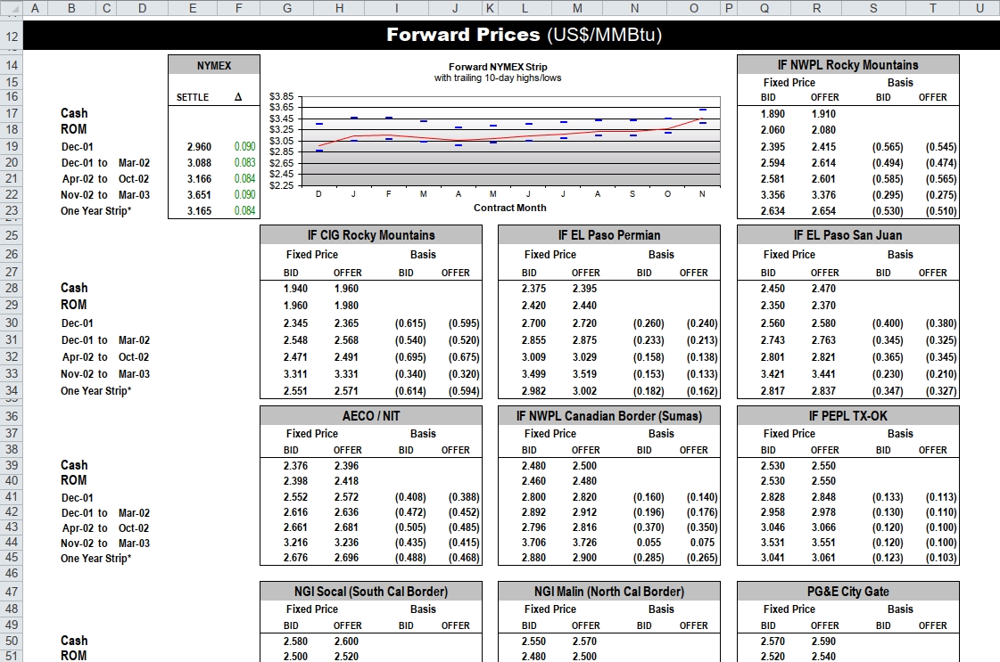

# Small Multiples

This vignette for the [unpivotr](https://github.com/nacnudus/unpivotr)
package demonstrates unpivoting multiple similar tables from a
spreadsheet via the [tidyxl](https://github.com/nacnudus/tidyxl)
package. It is best read with the spreadsheet open in a spreadsheet
program, e.g. Excel, LibreOffice Calc or Gnumeric.

## Introduction

The spreadsheet is from the famous Enron subpoena, made available by
[Felienne Hermans](https://www.felienne.com/archives/3634), and has has
previously been publicised by Jenny Bryan and David Robinson, in
particular in Robinson’s article [‘Tidying an untidyable
dataset’](https://rpubs.com/dgrtwo/tidying-enron).

Here’s a screenshot:

``` r


```


## Preparation

This vignette uses several common packages.

``` r

library(unpivotr)
library(tidyxl)
library(dplyr)
```

    ## 
    ## Attaching package: 'dplyr'

    ## The following objects are masked from 'package:stats':
    ## 
    ##     filter, lag

    ## The following objects are masked from 'package:base':
    ## 
    ##     intersect, setdiff, setequal, union

``` r

library(purrr)
library(tidyr)
```

    ## 
    ## Attaching package: 'tidyr'

    ## The following objects are masked from 'package:unpivotr':
    ## 
    ##     pack, unpack

``` r

library(stringr)
```

The spreadsheet is distributed with the unpivotr package, so can be
loaded as a system file.

``` r

path <- system.file("extdata/enron.xlsx", package = "unpivotr")
```

## Main

### Importing the data

Spreadsheet cells are imported with the
[`xlsx_cells()`](https://nacnudus.github.io/tidyxl/reference/xlsx_cells.html)
function, which returns a data frame of all the cells in all the
requested sheets. By default, every sheet is imported, but we don’t have
to worry about that in this case because there is only one sheet in the
file. We can also straightaway discard rows above 14 and below 56, and
columns beyond 20.

``` r

cells <-
  xlsx_cells(path) %>%
  dplyr::filter(!is_blank, between(row, 14L, 56L), col <= 20) %>%
  select(row, col, data_type, numeric, character, date)
```

Cell formatting isn’t required for this vignette, but if it were, it
would be imported via `xlsx_formats(path)`.

``` r

formatting <- xlsx_formats(path)
```

### Importing one of the multiples

The small multiples each have exactly one ‘Fixed Price’ header cell, so
begin by filtering for those cells, and then move the selection up one
row to get the title cells. The title cells are the top-left corner cell
of each table.

``` r

title <-
  dplyr::filter(cells, character == "Fixed Price") %>%
  select(row, col) %>%
  mutate(row = row - 1L) %>%
  inner_join(cells, by = c("row", "col"))
```

Use these title cells to partition the sheet.

``` r

partitions <- partition(cells, title)
```

Taking one of the partitions, unpivot with
[`behead()`](https://nacnudus.github.io/unpivotr/reference/behead.md).
The compass directions `"NNW"` and `"N"` express the direction from each
data cell to its header. `"NNW"` means “look up and then left to find
the nearest header.”

``` r

partitions$cells[[1]] %>%
  behead("NNW", "title") %>%
  behead("NNW", "price") %>%
  behead("N", "bid_offer") %>%
  print(n = Inf)
```

    ## # A tibble: 24 × 9
    ##      row   col data_type numeric character date   title                   price 
    ##    <int> <int> <chr>       <dbl> <chr>     <dttm> <chr>                   <chr> 
    ##  1    17    17 numeric     1.89  NA        NA     IF NWPL Rocky Mountains Fixed…
    ##  2    17    18 numeric     1.91  NA        NA     IF NWPL Rocky Mountains Fixed…
    ##  3    18    17 numeric     2.06  NA        NA     IF NWPL Rocky Mountains Fixed…
    ##  4    18    18 numeric     2.08  NA        NA     IF NWPL Rocky Mountains Fixed…
    ##  5    19    17 numeric     2.40  NA        NA     IF NWPL Rocky Mountains Fixed…
    ##  6    19    18 numeric     2.42  NA        NA     IF NWPL Rocky Mountains Fixed…
    ##  7    20    17 numeric     2.59  NA        NA     IF NWPL Rocky Mountains Fixed…
    ##  8    20    18 numeric     2.61  NA        NA     IF NWPL Rocky Mountains Fixed…
    ##  9    21    17 numeric     2.58  NA        NA     IF NWPL Rocky Mountains Fixed…
    ## 10    21    18 numeric     2.60  NA        NA     IF NWPL Rocky Mountains Fixed…
    ## 11    22    17 numeric     3.36  NA        NA     IF NWPL Rocky Mountains Fixed…
    ## 12    22    18 numeric     3.38  NA        NA     IF NWPL Rocky Mountains Fixed…
    ## 13    23    17 numeric     2.63  NA        NA     IF NWPL Rocky Mountains Fixed…
    ## 14    23    18 numeric     2.65  NA        NA     IF NWPL Rocky Mountains Fixed…
    ## 15    19    19 numeric    -0.565 NA        NA     IF NWPL Rocky Mountains Basis 
    ## 16    19    20 numeric    -0.545 NA        NA     IF NWPL Rocky Mountains Basis 
    ## 17    20    19 numeric    -0.494 NA        NA     IF NWPL Rocky Mountains Basis 
    ## 18    20    20 numeric    -0.474 NA        NA     IF NWPL Rocky Mountains Basis 
    ## 19    21    19 numeric    -0.585 NA        NA     IF NWPL Rocky Mountains Basis 
    ## 20    21    20 numeric    -0.565 NA        NA     IF NWPL Rocky Mountains Basis 
    ## 21    22    19 numeric    -0.295 NA        NA     IF NWPL Rocky Mountains Basis 
    ## 22    22    20 numeric    -0.275 NA        NA     IF NWPL Rocky Mountains Basis 
    ## 23    23    19 numeric    -0.530 NA        NA     IF NWPL Rocky Mountains Basis 
    ## 24    23    20 numeric    -0.510 NA        NA     IF NWPL Rocky Mountains Basis 
    ## # ℹ 1 more variable: bid_offer <chr>

The same procedure can be mapped to every small multiple.

``` r

unpivoted <-
  purrr::map_dfr(partitions$cells,
                 ~ .x %>%
                   behead("NNW", "title") %>%
                   behead("NNW", "price") %>%
                   behead("N", "bid_offer")) %>%
  select(-data_type, -character, -date)
unpivoted
```

    ## # A tibble: 240 × 6
    ##      row   col numeric title                   price       bid_offer
    ##    <int> <int>   <dbl> <chr>                   <chr>       <chr>    
    ##  1    17    17    1.89 IF NWPL Rocky Mountains Fixed Price BID      
    ##  2    17    18    1.91 IF NWPL Rocky Mountains Fixed Price OFFER    
    ##  3    18    17    2.06 IF NWPL Rocky Mountains Fixed Price BID      
    ##  4    18    18    2.08 IF NWPL Rocky Mountains Fixed Price OFFER    
    ##  5    19    17    2.40 IF NWPL Rocky Mountains Fixed Price BID      
    ##  6    19    18    2.42 IF NWPL Rocky Mountains Fixed Price OFFER    
    ##  7    20    17    2.59 IF NWPL Rocky Mountains Fixed Price BID      
    ##  8    20    18    2.61 IF NWPL Rocky Mountains Fixed Price OFFER    
    ##  9    21    17    2.58 IF NWPL Rocky Mountains Fixed Price BID      
    ## 10    21    18    2.60 IF NWPL Rocky Mountains Fixed Price OFFER    
    ## # ℹ 230 more rows

So far, only the column headers have been joined, but there are also row
headers on the left-hand side of the spreadsheet. The following code
incorporates these into the final dataset.

``` r

row_headers <-
  cells %>%
  dplyr::filter(between(row, 17, 56), between(col, 2, 4)) %>%
  # Concatenate rows like "Dec-01", "to", "Mar-02"
  mutate(character = ifelse(!is.na(character),
                            character,
                            format(date, origin="1899-12-30", "%b-%y"))) %>%
  select(row, col, character) %>%
  nest(-row) %>%
  mutate(row_header = map(data,
                          ~ str_trim(paste(.x$character, collapse = " ")))) %>%
  unnest(row_header) %>%
  mutate(col = 2L) %>%
  select(row, row_header)
```

    ## Warning: Supplying `...` without names was deprecated in tidyr 1.0.0.
    ## ℹ Please specify a name for each selection.
    ## ℹ Did you want `data = -row`?
    ## Call `lifecycle::last_lifecycle_warnings()` to see where this warning was
    ## generated.

``` r

unpivoted <- left_join(unpivoted, row_headers, by = "row")
unpivoted
```

    ## # A tibble: 240 × 7
    ##      row   col numeric title                   price       bid_offer row_header 
    ##    <int> <int>   <dbl> <chr>                   <chr>       <chr>     <chr>      
    ##  1    17    17    1.89 IF NWPL Rocky Mountains Fixed Price BID       Cash       
    ##  2    17    18    1.91 IF NWPL Rocky Mountains Fixed Price OFFER     Cash       
    ##  3    18    17    2.06 IF NWPL Rocky Mountains Fixed Price BID       ROM        
    ##  4    18    18    2.08 IF NWPL Rocky Mountains Fixed Price OFFER     ROM        
    ##  5    19    17    2.40 IF NWPL Rocky Mountains Fixed Price BID       Dec-01     
    ##  6    19    18    2.42 IF NWPL Rocky Mountains Fixed Price OFFER     Dec-01     
    ##  7    20    17    2.59 IF NWPL Rocky Mountains Fixed Price BID       Dec-01 to …
    ##  8    20    18    2.61 IF NWPL Rocky Mountains Fixed Price OFFER     Dec-01 to …
    ##  9    21    17    2.58 IF NWPL Rocky Mountains Fixed Price BID       Apr-02 to …
    ## 10    21    18    2.60 IF NWPL Rocky Mountains Fixed Price OFFER     Apr-02 to …
    ## # ℹ 230 more rows

## 34-line code listing

``` r

library(unpivotr)
library(tidyxl)
library(dplyr)
library(purrr)
library(tidyr)
library(stringr)

cells <-
  xlsx_cells(system.file("extdata/enron.xlsx", package = "unpivotr")) %>%
  dplyr::filter(!is_blank, between(row, 14L, 56L), col <= 20) %>%
  select(row, col, data_type, numeric, character, date)

row_headers <-
  dplyr::filter(cells, between(row, 17, 56), between(col, 2, 4)) %>%
  mutate(character = ifelse(!is.na(character),
                            character,
                            format(date, origin="1899-12-30", "%b-%y"))) %>%
  select(row, col, character) %>%
  nest(-row) %>%
  mutate(row_header = map(data,
                          ~ str_trim(paste(.x$character, collapse = " ")))) %>%
  unnest(row_header) %>%
  mutate(col = 2L) %>%
  select(row, row_header)

titles <-
  dplyr::filter(cells, character == "Fixed Price") %>%
  select(row, col) %>%
  mutate(row = row - 1L) %>%
  inner_join(cells, by = c("row", "col"))

partition(cells, titles)$cells %>%
  purrr::map_dfr(~ .x %>%
                 behead("NNW", "title") %>%
                 behead("NNW", "price") %>%
                 behead("N", "bid_offer")) %>%
  select(-data_type, -character, -date) %>%
  left_join(row_headers, by = "row")
```
